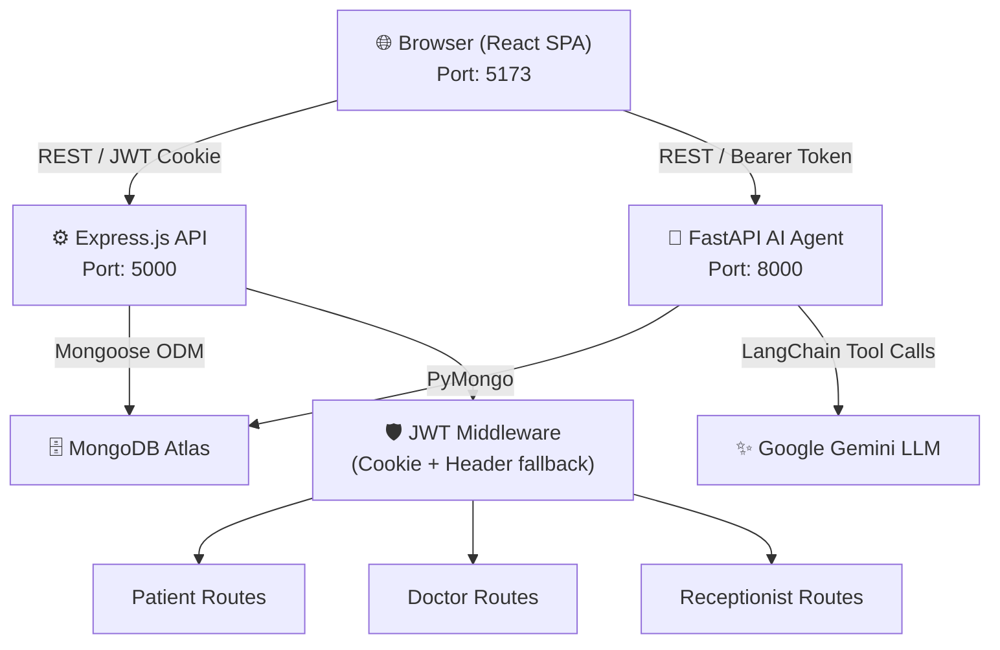

# Software Requirements Specification (SRS)
## CareFlow — Enterprise Hospital Management System

| Field | Value |
|---|---|
| **Document Version** | 1.0 |
| **Date** | October 15, 2026 |
| **Project** | CareFlow HMS |
| **Repository** | kiratjot-singh/Hospital-Management-System |
| **Status** | Released |

---

## Table of Contents

1. [Introduction](#1-introduction)
2. [Overall Description](#2-overall-description)
3. [Stakeholders & User Roles](#3-stakeholders--user-roles)
4. [Functional Requirements](#4-functional-requirements)
   - 4.1 [Authentication & Authorization](#41-authentication--authorization)
   - 4.2 [Patient Module](#42-patient-module)
   - 4.3 [Doctor Module](#43-doctor-module)
   - 4.4 [Receptionist Module](#44-receptionist-module)
   - 4.5 [Hospital & Clinic Module](#45-hospital--clinic-module)
   - 4.6 [Appointment & Slot Management](#46-appointment--slot-management)
   - 4.7 [AI Chat Assistant (CareFlow AI)](#47-ai-chat-assistant-careflow-ai)
5. [Non-Functional Requirements](#5-non-functional-requirements)
6. [Data Models](#6-data-models)
7. [API Specification Summary](#7-api-specification-summary)
8. [System Architecture](#8-system-architecture)
9. [Deployment & DevOps](#9-deployment--devops)
10. [Constraints & Assumptions](#10-constraints--assumptions)
11. [Glossary](#11-glossary)

---

## 1. Introduction

### 1.1 Purpose
This Software Requirements Specification (SRS) documents the functional and non-functional requirements for **CareFlow**, a full-stack, multi-role Hospital Management System. The document serves as the authoritative reference for developers, testers, and stakeholders throughout the software development lifecycle.

### 1.2 Scope
CareFlow is a web-based platform that streamlines the end-to-end workflow of a hospital or clinic. It enables:
- **Patients** to discover hospitals, browse departments and doctors, and book or cancel appointments.
- **Doctors** to manage their schedules, review appointments, configure their working hours, and toggle their availability.
- **Receptionists** to manage walk-in patient registrations, monitor doctor schedules, and oversee the appointment queue.
- An **AI Chat Assistant** (CareFlow AI) to serve patients with real-time, data-driven answers using tool-augmented LLM reasoning.

### 1.3 Definitions, Acronyms, and Abbreviations
| Term | Definition |
|---|---|
| HMS | Hospital Management System |
| JWT | JSON Web Token — used for stateless authentication |
| OTP | One-Time Password — used for email-based authentication |
| ODM | Object Document Mapper (Mongoose for MongoDB) |
| SPA | Single-Page Application |
| REST | Representational State Transfer |
| LLM | Large Language Model (Google Gemini) |
| Slot | A specific time block in a doctor's schedule (e.g., `10:00-10:15`) |

### 1.4 References
- Project README: `d:\Main projects\HMS\README.md`
- Backend API: Express.js + Node.js (`d:\Main projects\HMS\Backend\`)
- Frontend: React.js + Vite (`d:\Main projects\HMS\Frontend\`)
- AI Agent: FastAPI + Python + LangChain (`d:\Main projects\HMS\agent\`)

---

## 2. Overall Description

### 2.1 Product Perspective
CareFlow is a standalone, full-stack web application composed of three independent services:

| Service | Technology | Port |
|---|---|---|
| Frontend (SPA) | React.js (Vite), Framer Motion, Vanilla CSS | 5173 |
| Backend API Gateway | Node.js, Express.js | 5000 |
| AI Agent Service | Python, FastAPI, LangChain, Gemini | 8000 |

All services communicate over HTTP/HTTPS and share a common MongoDB Atlas database.

### 2.2 Product Features (High Level)
- Multi-role user registration and authentication (Patient, Doctor, Receptionist)
- Hospital and clinic registry with visual branding
- Department and doctor browsing
- Smart appointment scheduling with dynamic time-slot generation
- Real-time slot management (blocking, rescheduling, cancellation)
- AI-powered conversational assistant with live database access
- Containerized deployment via Docker Compose

### 2.3 User Classes and Characteristics
| User Class | Technical Proficiency | Primary Goal |
|---|---|---|
| Patient | Low–Medium | Find a hospital, book an appointment |
| Doctor | Medium | Manage schedule, view appointments, configure clinic |
| Receptionist | Medium | Register walk-ins, oversee daily patient flow |

### 2.4 Operating Environment
- **Client**: Any modern web browser (Chrome, Firefox, Edge, Safari)
- **Server OS**: Linux (Docker container) or Windows (local dev)
- **Database**: MongoDB Atlas (cloud-hosted NoSQL)
- **Runtime**: Node.js v16+, Python 3.10+

---

## 3. Stakeholders & User Roles

### 3.1 Roles

| Role | Description |
|---|---|
| **Patient** | A registered end-user who books appointments. Authenticated via phone + password. |
| **Doctor** | A medical professional registered under a hospital. Authenticated via phone + OTP or password. |
| **Receptionist** | A hospital staff member who manages walk-in patients. Authenticated via email/phone + OTP. |
| **System Administrator** | DevOps/Developer who manages deployment, database, and environment config. |

### 3.2 Role Separation
Each role has strictly isolated API routes protected by dedicated middleware guards (`protectPatient`, `protectDoctor`, `protectUser`). Cross-role access is explicitly denied.

---

## 4. Functional Requirements

### 4.1 Authentication & Authorization

#### 4.1.1 Receptionist Authentication
| ID | Requirement |
|---|---|
| FR-AUTH-01 | The system SHALL allow a receptionist to sign up with: name, phone number, email, password, and associated hospital. |
| FR-AUTH-02 | The system SHALL allow a receptionist to log in using password-based authentication. |
| FR-AUTH-03 | The system SHALL support email OTP login: send OTP to registered email (`POST /api/receptionist/send-email-otp`) and verify it (`POST /api/receptionist/verify-email-otp`). |
| FR-AUTH-04 | The system SHALL issue a JWT token upon successful login and set it as an HTTP-Only cookie. |
| FR-AUTH-05 | The system SHALL allow a receptionist to log out, invalidating the session cookie. |
| FR-AUTH-06 | The system SHALL allow fetching the logged-in receptionist's name (`POST /api/receptionist/getname`). |

#### 4.1.2 Doctor Authentication
| ID | Requirement |
|---|---|
| FR-AUTH-10 | The system SHALL allow a doctor to sign up with: name, phone, password, qualifications, experience, departments, hospital, working hours, and slot duration. |
| FR-AUTH-11 | The system SHALL allow a doctor to log in using phone + password. |
| FR-AUTH-12 | The system SHALL allow a doctor to log out. |
| FR-AUTH-13 | The system SHALL issue a role-encoded JWT (`role: "doctor"`) upon successful doctor login. |

#### 4.1.3 Patient Authentication
| ID | Requirement |
|---|---|
| FR-AUTH-20 | The system SHALL allow a patient to register with: name, phone number, password, state, and district. |
| FR-AUTH-21 | The system SHALL allow a patient to log in with phone + password. |
| FR-AUTH-22 | The system SHALL allow a patient to log out, clearing the session. |
| FR-AUTH-23 | The system SHALL issue a role-encoded JWT (`role: "patient"`) upon successful patient login. |

#### 4.1.4 Dual-Layer Token Extraction
| ID | Requirement |
|---|---|
| FR-AUTH-30 | The auth middleware SHALL first check for the JWT in the HTTP-Only cookie. |
| FR-AUTH-31 | If no cookie is found, the middleware SHALL fall back to the `Authorization: Bearer <token>` header. This is required for cross-origin environments where third-party cookies may be blocked. |

---

### 4.2 Patient Module

| ID | Requirement |
|---|---|
| FR-PAT-01 | A patient SHALL be able to view a home dashboard listing nearby hospitals after login. |
| FR-PAT-02 | A patient SHALL be able to search hospitals by name or area (city/state). |
| FR-PAT-03 | A patient SHALL be able to view detailed information for any hospital (address, departments, contact). |
| FR-PAT-04 | A patient SHALL be able to browse departments within a hospital. |
| FR-PAT-05 | A patient SHALL be able to view all doctors listed under a specific department, including qualifications and experience. |
| FR-PAT-06 | A patient SHALL be able to view available appointment slots for a doctor on a chosen date. |
| FR-PAT-07 | A patient SHALL be able to book an appointment by selecting a doctor, date, and a free slot. |
| FR-PAT-08 | A patient SHALL be able to provide an optional reason when booking an appointment. |
| FR-PAT-09 | A patient SHALL be able to view all their booked (upcoming) appointments. |
| FR-PAT-10 | A patient SHALL be able to cancel a booked appointment. |
| FR-PAT-11 | A patient SHALL be able to view their own profile (name, phone, state, district). |
| FR-PAT-12 | A patient SHALL be able to save hospitals to a favourites list (`savedHospitals`). |
| FR-PAT-13 | A patient SHALL be able to configure location preferences (state, district) after signup. |

---

### 4.3 Doctor Module

| ID | Requirement |
|---|---|
| FR-DOC-01 | A doctor SHALL be able to view a personal workspace dashboard showing key statistics: today's visit count, pending queue, and completed consultations. |
| FR-DOC-02 | A doctor SHALL be able to toggle their availability status (available / unavailable). |
| FR-DOC-03 | A doctor SHALL be able to update their working shift hours (start time, end time) and slot duration (in minutes). |
| FR-DOC-04 | When a doctor updates shift hours or slot duration, the system SHALL automatically delete and regenerate all future free (unbooked) slots without affecting already booked appointments. |
| FR-DOC-05 | A doctor SHALL be able to view a list of all appointments scheduled for them on a given date. |
| FR-DOC-06 | A doctor SHALL be able to block/unblock individual time slots (mark a slot as `blocked`). |
| FR-DOC-07 | A doctor SHALL be able to reschedule an existing appointment to a new date/slot. |
| FR-DOC-08 | A doctor SHALL be able to update the status of an appointment (e.g., mark as `completed`). |
| FR-DOC-09 | A doctor SHALL be able to configure or update the hospital/clinic they are associated with through the Clinic Configuration Center. |
| FR-DOC-10 | During signup, a doctor SHALL have the option to create a new hospital/clinic on-the-fly if one does not already exist. |
| FR-DOC-11 | A doctor SHALL be associated with one or more medical departments within a hospital. |

---

### 4.4 Receptionist Module

| ID | Requirement |
|---|---|
| FR-REC-01 | A receptionist SHALL be able to view a home dashboard showing all doctors in their associated hospital. |
| FR-REC-02 | A receptionist SHALL be able to see the availability status and active status of each doctor. |
| FR-REC-03 | A receptionist SHALL be able to navigate to any doctor's appointment schedule for a specific date. |
| FR-REC-04 | A receptionist SHALL be able to register a walk-in patient and assign them to an open slot on a doctor's schedule. |
| FR-REC-05 | A receptionist SHALL be able to toggle a doctor's availability status from the dashboard. |

---

### 4.5 Hospital & Clinic Module

| ID | Requirement |
|---|---|
| FR-HOS-01 | The system SHALL maintain a registry of hospitals with: name, image/logo, address (street, city, state, pincode), contact (phone, email), established year, and public/private classification. |
| FR-HOS-02 | Any user SHALL be able to fetch the list of all registered hospitals (`GET /api/hospital/getHospitals`). |
| FR-HOS-03 | Any user SHALL be able to retrieve detailed information for a specific hospital by ID. |
| FR-HOS-04 | A doctor (authenticated) SHALL be able to update hospital details such as branding, address, and contact information (`PATCH /api/hospital/update/:id`). |
| FR-HOS-05 | The system SHALL support medical departments, each linked to a hospital, as a distinct data entity. |
| FR-HOS-06 | Doctors SHALL be fetchable by department ID (`GET /api/doctor/deptdoctors/:id`). |

---

### 4.6 Appointment & Slot Management

| ID | Requirement |
|---|---|
| FR-APT-01 | The system SHALL use a time-slot model where each slot represents a specific time block (e.g., `10:00-10:15`) for a given doctor, hospital, and date. |
| FR-APT-02 | Slots SHALL be lazily generated: when a patient or the AI agent requests slots for a date where none exist, the system SHALL auto-generate them based on the doctor's working hours and slot duration. |
| FR-APT-03 | The system SHALL enforce a **60-day booking horizon**: appointments cannot be booked for dates more than 60 days in the future or in the past. |
| FR-APT-04 | The system SHALL prevent double-booking by enforcing a unique database index on `{doctor, hospital, date, slot}`. |
| FR-APT-05 | Slot reservation SHALL be atomic: the system uses a `find_one_and_update` (or equivalent) pattern to reserve a slot only if its current status is `free`. |
| FR-APT-06 | A slot's status SHALL be one of: `free`, `booked`, `blocked`. |
| FR-APT-07 | An appointment's status SHALL be one of: `booked`, `cancelled`, `completed`. |
| FR-APT-08 | Upon appointment cancellation, the associated slot SHALL be reset to `free` and its patient/appointment references cleared. |
| FR-APT-09 | Upon cancellation, the appointment ID SHALL be moved from the patient's `bookedAppointments` array to `previousAppointments`. |
| FR-APT-10 | The system SHALL automatically purge past, unbooked (free) slots to keep the database clean. |
| FR-APT-11 | A patient or receptionist SHALL be able to view all free slots for a doctor on a specific date (`GET /api/appointments/free-slots`). |
| FR-APT-12 | A doctor or receptionist SHALL be able to view all slot documents for a doctor (`GET /api/appointments/slots`). |
| FR-APT-13 | Appointment rescheduling SHALL be available to any authenticated user (patient, doctor, or receptionist) via `PATCH /api/appointments/:id/reschedule`. |

---

### 4.7 AI Chat Assistant (CareFlow AI)

The CareFlow AI is a separate microservice (FastAPI, Python) powered by Google Gemini with LangChain tool calling.

#### 4.7.1 General Behavior
| ID | Requirement |
|---|---|
| FR-AI-01 | The AI assistant SHALL greet patients and answer questions about the CareFlow platform. |
| FR-AI-02 | The AI SHALL provide empathetic, concise, and professional responses. |
| FR-AI-03 | For any medical questions, the AI SHALL provide general guidance and ALWAYS recommend the patient consult a qualified doctor. |
| FR-AI-04 | The AI SHALL maintain conversation context across multiple turns using the `history` field in the chat request. |
| FR-AI-05 | The AI SHALL be aware of the current date (injected into the system prompt). |
| FR-AI-06 | When a patient is logged in, the AI SHALL be personalized with the patient's name and ID. |
| FR-AI-07 | When no patient is logged in, the AI SHALL decline to perform booking or cancellation actions. |

#### 4.7.2 Tool Capabilities
The AI agent has access to the following real-time database tools:

| Tool | Description |
|---|---|
| `get_hospitals(search_query?)` | Search and list all hospitals, optionally filtered by name, city, or state. |
| `get_hospital_details(hospital_id)` | Fetch full details of a hospital including its departments and all doctors. |
| `get_doctor_details(doctor_id)` | Fetch a doctor's profile including qualifications, experience, working hours, and departments. |
| `get_available_slots(doctor_id, hospital_id, date)` | Retrieve all free appointment slots for a doctor on a given date. Triggers lazy slot generation. |
| `get_patient_appointments(patient_id)` | List all appointments for the currently logged-in patient. |
| `book_appointment(patient_id, doctor_id, hospital_id, date, slot, reason?)` | Book an appointment on behalf of the logged-in patient, with full validation and atomic slot reservation. |
| `cancel_appointment(appointment_id)` | Cancel a booked appointment and free the associated slot. |

#### 4.7.3 Authentication
| ID | Requirement |
|---|---|
| FR-AI-10 | The AI service SHALL accept a JWT token via `Authorization: Bearer` header or the `token` field in the request body. |
| FR-AI-11 | The service SHALL decode the JWT and verify the role is `patient`. |
| FR-AI-12 | If the token is expired, the service SHALL return a 401 error. |
| FR-AI-13 | If the role is not `patient`, the service SHALL return a 403 error. |
| FR-AI-14 | The service SHALL iterate the LLM tool-calling loop up to **5 times** per request to prevent runaway execution. |

---

## 5. Non-Functional Requirements

### 5.1 Performance
| ID | Requirement |
|---|---|
| NFR-PERF-01 | API endpoints for slot queries and appointment booking SHALL respond within 500ms under normal load. |
| NFR-PERF-02 | The MongoDB schema SHALL use compound unique indexes on `{doctor, hospital, date, slot}` in both the `Appointment` and `Slot` collections to ensure fast lookups and prevent race conditions. |
| NFR-PERF-03 | The `Slot` collection SHALL have additional indexes on `{patient}` and `{doctor}` fields for efficient patient and doctor queries. |

### 5.2 Security
| ID | Requirement |
|---|---|
| NFR-SEC-01 | All passwords SHALL be hashed using bcrypt before storage. |
| NFR-SEC-02 | JWTs SHALL be signed with a secret key (`JWT_SECRET`) configured via environment variables, never hard-coded. |
| NFR-SEC-03 | Session tokens SHALL be set as HTTP-Only cookies to mitigate XSS attacks. |
| NFR-SEC-04 | All sensitive configuration (DB URI, API keys, JWT secrets) SHALL be stored in `.env` files and excluded from version control via `.gitignore`. |
| NFR-SEC-05 | Role-based access control SHALL be enforced on every protected route at the middleware layer. |
| NFR-SEC-06 | OTP tokens SHALL have an expiry time (`otpExpires` field) and SHALL be invalid after expiry. |

### 5.3 Reliability & Data Integrity
| ID | Requirement |
|---|---|
| NFR-REL-01 | Slot reservation SHALL be atomic using MongoDB's `findOneAndUpdate` with a status precondition to prevent double-booking under concurrent requests. |
| NFR-REL-02 | The unique index on Appointment ensures no duplicate appointment records can be created at the database level as a final safeguard. |
| NFR-REL-03 | The system SHALL gracefully handle database connection failures and return meaningful error messages rather than crashing. |

### 5.4 Usability
| ID | Requirement |
|---|---|
| NFR-USE-01 | The frontend SHALL be a Single-Page Application (SPA) with client-side routing using React Router. |
| NFR-USE-02 | The UI SHALL feature a glassmorphism-inspired dark mode design with micro-animations (Framer Motion) for a premium user experience. |
| NFR-USE-03 | The UI SHALL be responsive and functional across modern desktop and mobile browsers. |

### 5.5 Scalability
| ID | Requirement |
|---|---|
| NFR-SCA-01 | Each of the three services (Frontend, Backend, Agent) SHALL be independently deployable and scalable as Docker containers. |
| NFR-SCA-02 | The database (MongoDB Atlas) is cloud-hosted and scales independently of the application servers. |

### 5.6 Maintainability
| ID | Requirement |
|---|---|
| NFR-MNT-01 | The backend SHALL follow an MVC-style separation: `models/`, `controllers/`, `routes/`, `middleware/`. |
| NFR-MNT-02 | Environment-specific configuration SHALL be managed via `.env` files with `.env.example` files provided for onboarding. |
| NFR-MNT-03 | The project SHALL be containerized with `Dockerfile` and `docker-compose.yml` to ensure reproducible development and deployment environments. |

---

## 6. Data Models

### 6.1 Patient
| Field | Type | Constraints |
|---|---|---|
| `phonenumber` | String | Required |
| `password` | String | Required, bcrypt-hashed |
| `name` | String | Required |
| `state` | String | Optional |
| `district` | String | Optional |
| `bookedAppointments` | ObjectId[] | References `Appointment` |
| `savedHospitals` | ObjectId[] | References `Hospital` |
| `previousAppointements` | ObjectId[] | References `Appointment` |

### 6.2 Doctor
| Field | Type | Constraints |
|---|---|---|
| `name` | String | Required |
| `phone` | String | Required, Unique |
| `departments` | ObjectId[] | References `Department`, Required |
| `password` | String | Optional (OTP auth supported) |
| `otp` | String | Optional |
| `otpExpires` | Date | Optional |
| `qualifications` | String | Required, default: `"MBBS"` |
| `hospital` | ObjectId | References `Hospital`, Required |
| `experience` | Number | Default: 0 |
| `image` | String | Profile photo URL |
| `available` | Boolean | Default: false |
| `active` | Boolean | Default: true (soft-delete) |
| `workingHours.start` | String | Time string, e.g., `"10:00"` |
| `workingHours.end` | String | Time string, e.g., `"17:00"` |
| `slotDuration` | Number | Duration in minutes, default: 0 |

### 6.3 Receptionist
| Field | Type | Constraints |
|---|---|---|
| `name` | String | Required |
| `phone` | String | Required, Unique |
| `email` | String | Required |
| `password` | String | Optional |
| `otp` | String | Optional |
| `otpExpires` | Date | Optional |
| `hospital` | ObjectId | References `Hospital`, Required |

### 6.4 Hospital
| Field | Type | Constraints |
|---|---|---|
| `name` | String | Required |
| `image` | String | URL, Optional |
| `address.street` | String | Optional |
| `address.city` | String | Optional |
| `address.state` | String | Optional |
| `address.pincode` | String | Optional |
| `contact.phone` | String | Optional |
| `contact.email` | String | Optional |
| `doctors` | ObjectId[] | References `Doctor` |
| `establishedYear` | Number | Optional |
| `isPrivate` | Boolean | Default: true |

### 6.5 Appointment
| Field | Type | Constraints |
|---|---|---|
| `doctor` | ObjectId | References `Doctor`, Required |
| `patient` | ObjectId | References `Patient` |
| `hospital` | ObjectId | References `Hospital`, Required |
| `date` | Date | Required |
| `slot` | String | Required (e.g., `"10:00-10:15"`) |
| `reason` | String | Default: `""` |
| `status` | Enum | `booked` \| `cancelled` \| `completed`, default: `booked` |
| — | Unique Index | `{doctor, hospital, date, slot}` |

### 6.6 Slot
| Field | Type | Constraints |
|---|---|---|
| `doctor` | ObjectId | References `Doctor`, Required |
| `hospital` | ObjectId | References `Hospital`, Required |
| `date` | Date | Required |
| `slot` | String | Required (e.g., `"10:00-10:15"`) |
| `status` | Enum | `free` \| `booked` \| `blocked`, Required |
| `patient` | ObjectId | References `Patient`, nullable |
| `appointment` | ObjectId | References `Appointment`, nullable |
| — | Unique Index | `{doctor, hospital, date, slot}` |
| — | Index | `{patient}`, `{doctor}` |

### 6.7 Department
| Field | Type | Constraints |
|---|---|---|
| `name` | String | Required |
| *(hospital link)* | ObjectId | Implicitly linked via doctor's department references |

---

## 7. API Specification Summary

### 7.1 Receptionist / Auth Routes (`/api/receptionist`)
| Method | Endpoint | Auth | Description |
|---|---|---|---|
| POST | `/signup` | None | Register a new receptionist |
| POST | `/login-password` | None | Login with password |
| POST | `/send-email-otp` | None | Send OTP to registered email |
| POST | `/verify-email-otp` | None | Verify OTP and issue JWT |
| POST | `/getname` | None | Get receptionist name by phone |
| PATCH | `/:id/availability` | None | Toggle doctor availability |
| POST | `/logout` | None | Logout and clear session |

### 7.2 Doctor Routes (`/api/doctor`)
| Method | Endpoint | Auth | Description |
|---|---|---|---|
| POST | `/signup` | None | Register a new doctor |
| POST | `/login` | None | Doctor login |
| POST | `/logout` | None | Doctor logout |
| GET | `/getDoctor/:id` | None | Fetch doctor details by ID |
| POST | `/getDepartment` | None | Fetch departments for a hospital |
| GET | `/deptdoctors/:id` | None | Fetch doctors by department ID |
| PATCH | `/shift` | Doctor | Update working hours & slot duration |

### 7.3 Patient Routes (`/api/patient`)
| Method | Endpoint | Auth | Description |
|---|---|---|---|
| POST | `/signup` | None | Register a new patient |
| POST | `/login` | None | Patient login |
| POST | `/logout` | None | Patient logout |
| GET | `/me` | Patient | Get own patient profile |
| GET | `/hospitaldetails/:id` | None | Get hospital details |
| GET | `/` | Any Auth | List all patients |

### 7.4 Hospital Routes (`/api/hospital`)
| Method | Endpoint | Auth | Description |
|---|---|---|---|
| GET | `/getHospitals` | None | List all hospitals |
| GET | `/getHospital/:id` | None | Get a single hospital by ID |
| PATCH | `/update/:id` | Doctor | Update hospital information |

### 7.5 Appointment Routes (`/api/appointments`)
| Method | Endpoint | Auth | Description |
|---|---|---|---|
| POST | `/book` | Patient | Book a new appointment |
| GET | `/slots` | None | Get all slot documents for a doctor/date |
| GET | `/free-slots` | None | Get free slots for a doctor/date |
| GET | `/doctor/:doctorId` | Doctor | Get all appointments for a doctor |
| GET | `/patient/:patientId` | Patient | Get all appointments for a patient |
| PATCH | `/:id/status` | Any Auth | Update appointment status |
| PATCH | `/slots/toggle-block` | Doctor | Block/unblock a time slot |
| PATCH | `/:id/reschedule` | Any Auth | Reschedule an appointment |

### 7.6 AI Agent Routes (`/api/chat`)
| Method | Endpoint | Auth | Description |
|---|---|---|---|
| POST | `/api/chat` | Optional (Patient JWT) | Send a message to CareFlow AI |
| GET | `/health` | None | Check AI service health status |

---

## 8. System Architecture

### 8.1 Frontend Routing Map
| Path | Component | Role |
|---|---|---|
| `/` | `RoleSelect` | Public |
| `/login/patient` | `PatientLogin` | Public |
| `/signup/patient` | `PatientSignup` | Public |
| `/home/patient/:phone` | `PatientHome` | Patient |
| `/patient/me/:patientId` | `PatientProfile` | Patient |
| `/preferences` | `PatientPreferences` | Patient |
| `/hospitaldetails/:id` | `HospitalDetails` | Patient |
| `/hospital/:hospitalId/department/:departmentId` | `DepartmentDoctors` | Patient |
| `/hospital/:hospitalId/doctor/:doctorId/slots` | `DoctorSlots` | Patient |
| `/confirm-appointment/:doctorId/:hospitalId/:date/:slot` | `ConfirmAppointment` | Patient |
| `/appointments/:patientId` | `Appointments` | Patient |
| `/login/doctor` | `DoctorLogin` | Public |
| `/signup/doctor` | `DoctorSignup` | Public |
| `/doctor/:id` | `DoctorPage` | Doctor |
| `/doctor/configure-clinic/:hospitalId` | `ConfigureClinic` | Doctor |
| `/login/receptionist` | `ReceptionistLogin` | Public |
| `/signup/receptionist` | `ReceptionistSignup` | Public |
| `/home/receptionist/:phone` | `ReceptionistHome` | Receptionist |
| `/receptionist/doctor/:id/appointments` | `DoctorAppointments` | Receptionist |

---

## 9. Deployment & DevOps

### 9.1 Docker Compose Services
The `docker-compose.yml` orchestrates three containers:

| Service | Build Context | Exposed Port |
|---|---|---|
| `frontend` | `./Frontend` | 5173 |
| `backend` | `./Backend` | 5000 |
| `agent` | `./agent` | 8000 |

### 9.2 Environment Variables

**Backend (`Backend/.env`)**
| Variable | Description |
|---|---|
| `PORT` | Port for the Express server (default: 5000) |
| `MONGO_URI` | MongoDB Atlas connection string |
| `JWT_SECRET` | Secret key for signing JWTs |
| `CLIENT_URL` | Allowed CORS origin (e.g., `http://localhost:5173`) |

**Frontend (`Frontend/.env`)**
| Variable | Description |
|---|---|
| `VITE_API_BASE_URL` | Base URL for backend API (e.g., `http://localhost:5000/api`) |

**AI Agent (`agent/.env`)**
| Variable | Description |
|---|---|
| `MONGO_URI` | MongoDB Atlas connection string |
| `GEMINI_API_KEY` | Google Gemini API key |
| `JWT_SECRET` | Same secret as backend (for JWT decoding) |
| `PORT` | Port for FastAPI server (default: 8000) |

### 9.3 CI/CD
The project includes a `.github/` directory indicating GitHub Actions-based CI/CD workflows.

---

## 10. Constraints & Assumptions

| # | Constraint / Assumption |
|---|---|
| C-01 | The booking horizon is strictly limited to **60 days** from the current date. |
| C-02 | Slot generation is **lazy** — slots are created on-demand when first queried. |
| C-03 | The AI agent's tool-calling loop is capped at **5 iterations** per request. |
| C-04 | Doctors must be associated with at least one hospital and one department at signup. |
| C-05 | The system uses **MongoDB Atlas** as the database and does not support other databases without schema changes. |
| C-06 | The AI assistant is restricted to **patient role only** when performing booking/cancellation operations. |
| C-07 | The application uses **phone numbers** as the primary unique identifier for Patients, Doctors, and Receptionists. |
| C-08 | The LLM model used for the AI agent is **Google Gemini** (specifically `gemini-3.5-flash`). |
| C-09 | Password-based and OTP-based authentication mechanisms are both supported depending on the role. |
| C-10 | Docker Compose is the primary deployment method; no Kubernetes orchestration is currently defined. |

---

## 11. Glossary

| Term | Definition |
|---|---|
| **Slot** | A discrete time block in a doctor's schedule (e.g., `10:00-10:15`). Stored as a MongoDB document with a status of `free`, `booked`, or `blocked`. |
| **Lazy Generation** | Slots are not pre-created in advance. They are generated on-the-fly when a patient or agent queries availability for a date without existing slots. |
| **Booking Horizon** | The maximum future date a patient can book an appointment — 60 days from today. |
| **HTTP-Only Cookie** | A browser cookie inaccessible to JavaScript, used to securely store JWT tokens. |
| **OTP** | A one-time password sent via email used as a second-factor for authentication. |
| **Walk-In Patient** | A patient who arrives physically at the hospital without a pre-booked appointment, registered by the receptionist directly into the system. |
| **CareFlow AI** | The AI-powered virtual assistant powered by Google Gemini, integrated into the patient portal for natural language appointment management. |
| **Atomic Reservation** | A slot booking operation that uses `findOneAndUpdate` to guarantee only one concurrent request can claim a slot, preventing double-booking. |
| **Soft Delete** | Doctors have an `active` boolean field. Setting `active: false` disables the doctor without removing the record from the database. |
